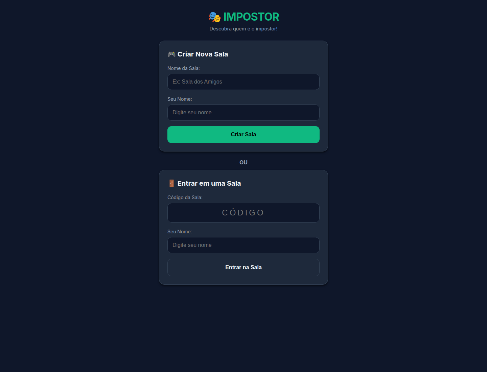
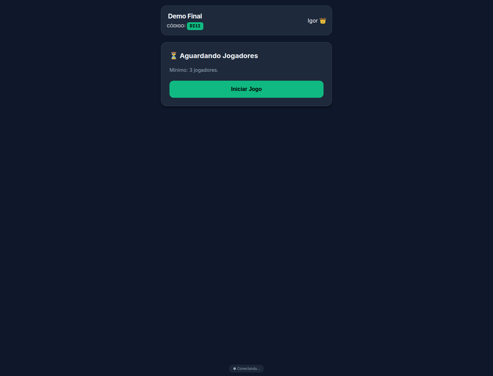

<h1 align="center" style="color:#F1F5F9;">
  Impostor
</h1>

<p align="center">
  <span style="color:#94A3B8; font-size:16px;">
    Uma aplicação web simples para o jogo 'impostor'
  </span>
</p>

<p align="center">
     
</p>

<p align="center">
  
</p>

<hr/>

<p align="center" style="background-color:#FEF3C7; border:1px solid #F59E0B; border-radius:8px; color:#92400E; padding:12px;">
  ⚠️ <strong>REPOSITÓRIO ARQUIVADO</strong><br/>
  Este projeto foi encerrado e não receberá mais manutenção, correções ou novas funcionalidades.
</p>

## Sobre o projeto

Aplicação web multiplayer simples para partidas do jogo **Impostor**, desenvolvida com Java, Spring Boot, Thymeleaf e WebSocket/STOMP.

### Funcionalidades

- Criar uma sala com nome personalizado.
- Entrar em uma sala usando um código curto.
- Aguardar jogadores e iniciar a partida como proprietário da sala.
- Distribuir palavras e identificar o impostor durante as rodadas.
- Votar, exibir o resultado e acompanhar a pontuação dos jogadores.

## Como executar localmente

Requisitos: Java 21.

```bash
GRADLE_USER_HOME=/tmp/impostor-gradle ./gradlew bootRun
```

Depois, acesse [http://localhost:8080](http://localhost:8080).

Para executar os testes:

```bash
GRADLE_USER_HOME=/tmp/impostor-gradle ./gradlew test
```


### Tela inicial



### Sala criada



## Status de arquivamento

Projeto mantido apenas como registro de uma implementação experimental. O repositório está arquivado e não receberá mais manutenção, correções ou novas funcionalidades.

Não há persistência de dados ou autenticação; o estado das salas é mantido em memória enquanto a aplicação está em execução.

---

<p align="center">
  
</p>

---

<p align="center">
  <strong style="font-size:16px;">Igor Moreira Alves</strong><br/>
  <span style="color:#94A3B8;">Back-end Software Engineer • Java • Python • Spring Boot • AWS</span>
</p>

<p align="center">
  <a href="https://alves-dev.com" target="_blank">
    
  </a>
  <a href="https://www.linkedin.com/in/alves-dev/" target="_blank">
    
  </a>
  <a href="https://github.com/alves-dev" target="_blank">
    
  </a>
</p>

<p align="center">
  <sub style="color:#94A3B8;">
    Atualizado em 2026-11-07
  </sub>
</p>
